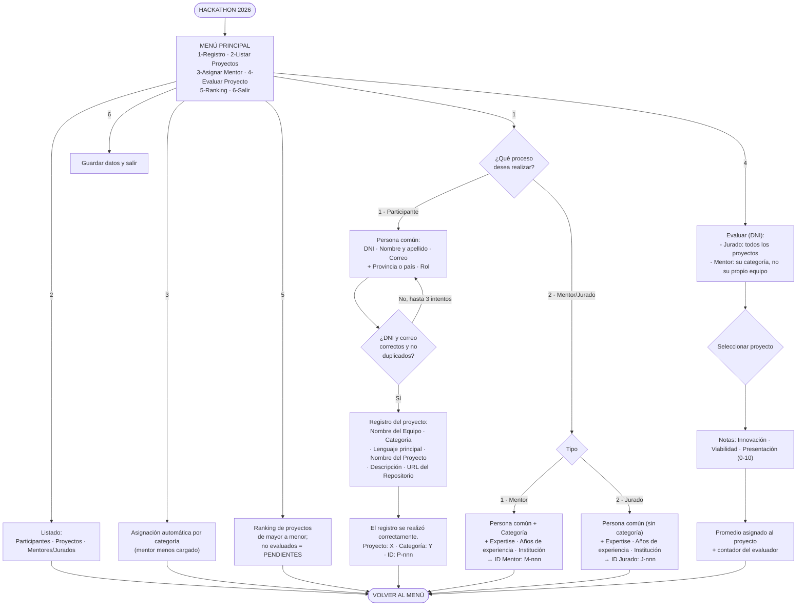

# Global - Hackathon 2026 (Ministerio de Deporte de San Luis)

Sistema en consola **C# (.NET 8)** que administra la inscripción de equipos
de desarrolladores, la asignación automática de mentores, el registro de
proyectos y la carga de evaluaciones del jurado calificador, con una tabla
de posiciones final.

El diseño respeta el **diagrama de flujo oficial (menú de 5 opciones)** y
**todos los campos exigidos por la consigna** (clase base
`ParticipanteHackathon`, subclases `Competidor` y `MentorJurado`, entidad
`Proyecto` con puntaje final **polimórfico** `CalcularPuntajeFinal()`).

## Cómo compilar y ejecutar

```powershell
cd E:\ulp\programacion\trabajoFinal\Hackathon2026v2
dotnet build
dotnet run
```

## Cómo probar (regresión por guiones)

Los guiones aportan las líneas de entrada (una por prompt). Como el estado
vive en memoria, cada corrida arranca con los datos en blanco y de
principio a fin en la misma pasada:

```powershell
Get-Content prueba-completa.txt        | dotnet run --no-build
Get-Content prueba-persona-jurados.txt | dotnet run --no-build
```

- `prueba-completa.txt`: registro completo (2 competidores Bio + 1 E-Sports,
  3 mentores, 2 jurados), asignación por categoría, evaluaciones de mentor y
  jurados, ranking con pendiente visible y el caso de DNI duplicado x3
  (mensaje "3 intentos" y regreso al menú).
- `prueba-persona-jurados.txt`: jurado que cruza categorías, mentor sin
  proyectos elegibles, reintentos con duplicados que terminan en alta
  válida y 3 intentos agotados.

### Pruebas unitarias del dominio

```powershell
dotnet test Hackathon2026v2.Tests
```

## Estructura del código

| Carpeta / archivo | Contenido |
|---|---|
| `Program.cs` | Menú principal y flujos de consola (solo orquesta) |
| `Models\ParticipanteHackathon.cs` | Clase base abstracta (ID Inscripción, Provincia/País, Rol + identidad común) |
| `Models\PersonaDatos.cs` | Parte común a los tres roles: DNI, correo y nombre, con sus verificaciones de unicidad |
| `Models\Competidor.cs` | Subclase: equipo, categoría, lenguaje, proyecto y mentor asignados (con validaciones) |
| `Models\MentorJurado.cs` | Subclase: expertise, experiencia, institución, categoría (solo mentores) y contadores de carga |
| `Models\Proyecto.cs` | Entidad abstracta: título, descripción, repositorio, evaluaciones encapsuladas |
| `Models\ProyectoESports.cs` / `ProyectoIoTDeportivo.cs` / `ProyectoBiomecanica.cs` | Subclases con los pesos de su categoría en `CalcularPuntajeFinal()` (polimorfismo) |
| `Models\CategoriaHackathon.cs` | Enumeraciones + helper de nombres |
| `UI\ValidadorConsola.cs` | Lecturas validadas; máximo 3 intentos por ingreso |
| `UI\IntentosAgotadosException.cs` | Señala los 3 intentos usados: el flujo vuelve al menú principal |
| `Hackathon2026v2.Tests\` | Proyecto de pruebas unitarias del dominio (xUnit) |

## Reglas de negocio implementadas

- **Registro**: DNI + correo únicos entre los tres roles, con hasta 3
  reintentos (duplicados o entradas inválidas); vencidos los 3, mensaje
  *"Ya se utilizaron los 3 intentos disponibles. Debe volver al menú
  principal."* y el flujo vuelve al menú sin cerrar el programa.
- **Participante**: inscribe su proyecto en el mismo flujo (equipo ->
  categoría -> lenguaje -> proyecto -> descripción -> repositorio).
- **Mentor**: registra categoría, expertise, experiencia e institución;
  acompaña equipos de SU categoría y puede evaluar los proyectos de su
  categoría **excluyendo el del equipo que acompaña**.
- **Jurado**: no registra categoría y evalúa **todos los proyectos que
  quiera**, de cualquier categoría (una evaluación por proyecto).
- **Asignación automática por categoría**: el equipo recibe al mentor de su
  categoría **menos cargado** (balanceo).
- **Evaluación**: notas de Innovación, Viabilidad y Presentación (0-10);
  el proyecto recalcula promedios y el puntaje final pondera según la
  categoría (polimorfismo); cada evaluador evalúa una sola vez cada
  proyecto y la nota conjunta promedia a todos los evaluadores.
- **Ranking**: de mayor a menor por puntaje final (empates comparten
  posición) y los proyectos sin evaluación se muestran como
  **PENDIENTES**, tal como pide el diagrama. El estado vive en memoria
  mientras la aplicación está abierta.

## Diagrama de flujo (versión implementada)


